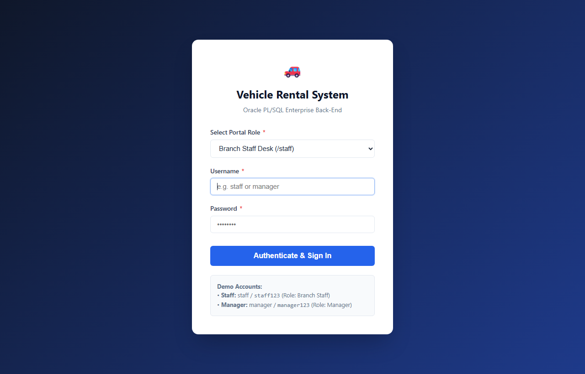
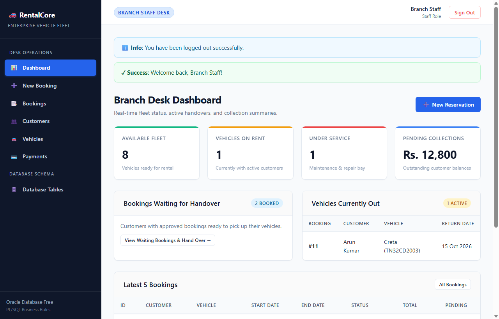
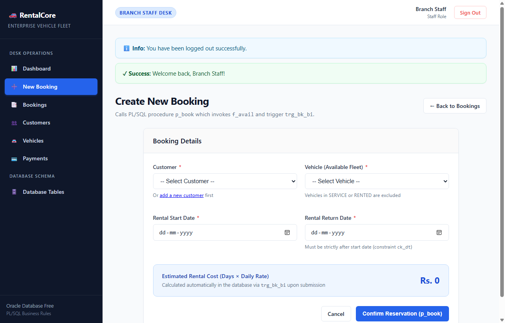
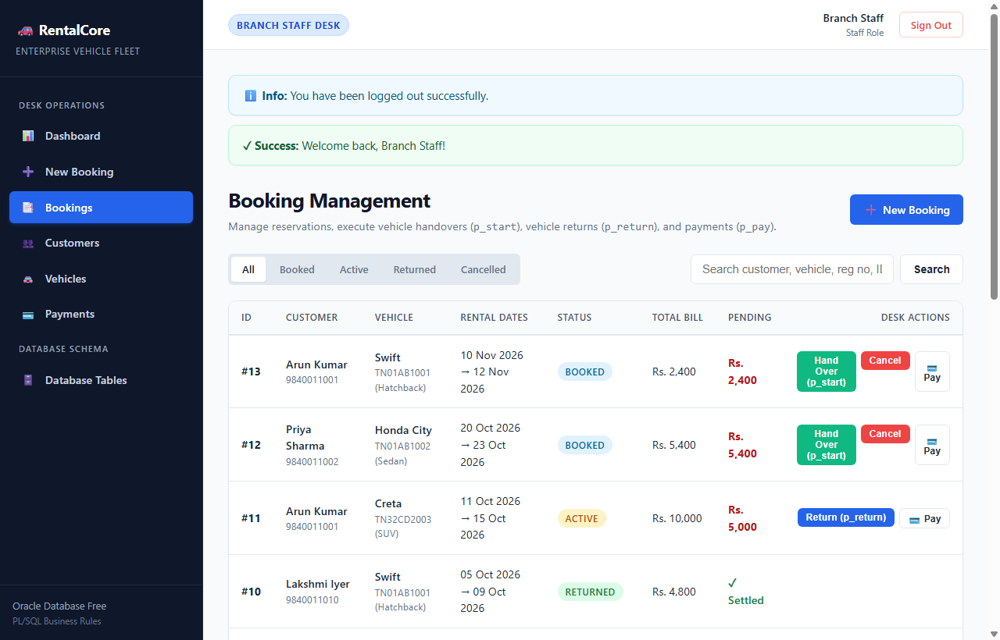
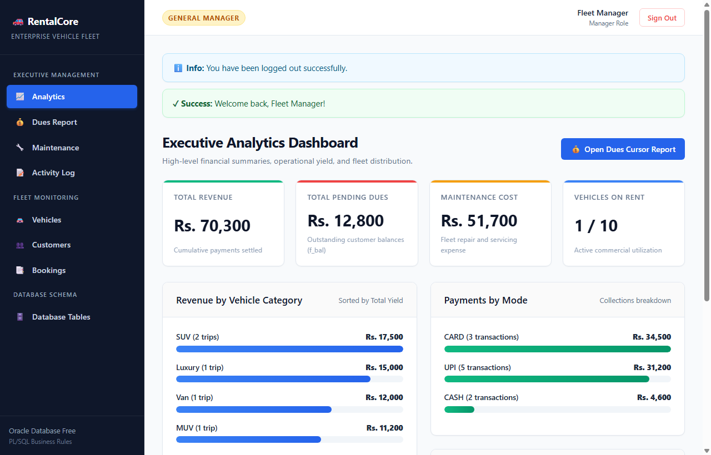
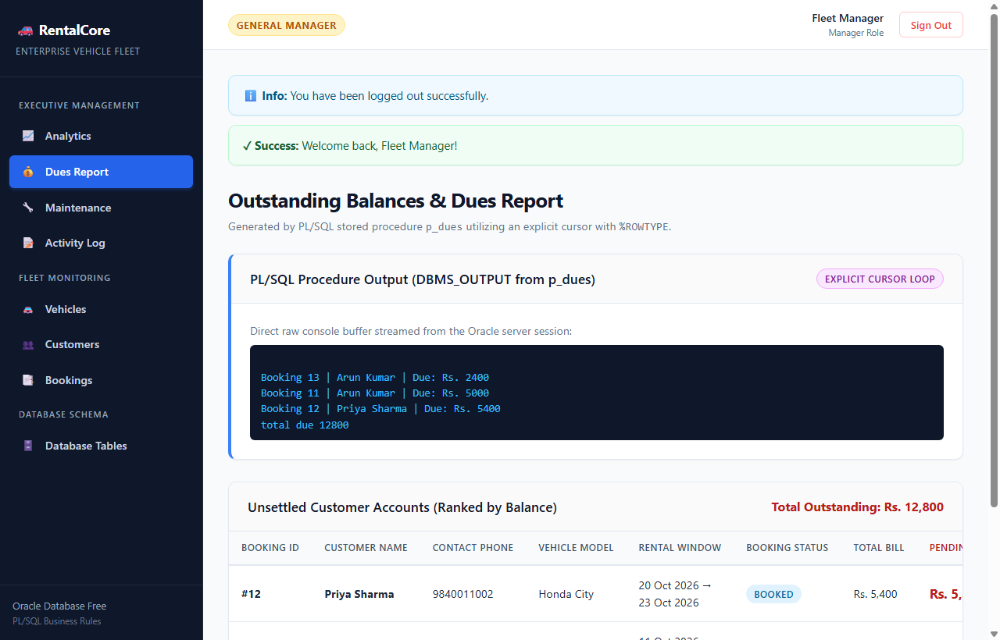
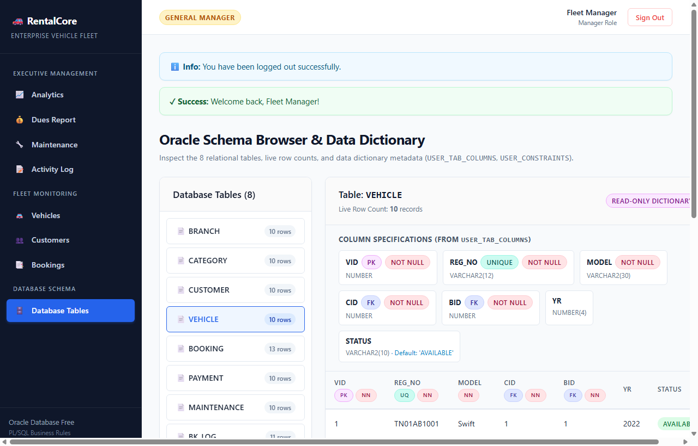

# Vehicle Rental Management System (VRMS)

[](https://www.oracle.com/database/)
[](https://www.python.org/)
[](https://flask.palletsprojects.com/)
[](LICENSE)

An enterprise-grade, full-stack database application developed for **BCSE302L – Database Systems** at **School of Computer Science Engineering and Information Systems (SCOPE), Vellore Institute of Technology (VIT)**.

All business rules, rate calculations, availability tracking, and audit logging reside strictly inside **Oracle Database (SQL & PL/SQL)**. The front end is a responsive **Python Flask** web portal offering dedicated workflows for Branch Staff and Fleet Managers without implementing any ORM or business logic in Python.

---

## Academic Credentials

| Parameter | Details |
| :--- | :--- |
| **Course** | BCSE302L – Database Systems |
| **Student Name** | Sarvesh R |
| **Registration Number** | 24BYB0081 |
| **Faculty Guide** | Prof. THANGA MARIAPPAN L |
| **School / Institution** | SCOPE, Vellore Institute of Technology (VIT), Vellore |
| **Academic Year** | 2025–2026 |

---

## Key Features & Highlights

- **Strict Database-Tier Architecture:** 100% of calculations, constraints, and operational logic reside in Oracle PL/SQL. Zero ORM used.
- **8 Normalized Relational Tables:** `branch`, `category`, `customer`, `vehicle`, `booking`, `payment`, `maintenance`, `bk_log` (3NF / BCNF).
- **Trigger-Enforced Safety:**
  - `trg_bk_bi` (Before Insert): Prevents booking vehicles under service and calculates booking totals automatically based on category rates.
  - `trg_bk_au` (After Update): Automatically transitions vehicle availability (`AVAILABLE` <-> `RENTED`) and writes immutable audit entries to `bk_log`.
- **Stored Functions & Procedures:**
  - Functions: `f_bal` (outstanding balance calculator), `f_avail` (temporal overlap & service validator).
  - Procedures: `p_book` (reservation), `p_start` (dispatch/trip start), `p_return` (check-in & dues), `p_pay` (payment collection & overpayment guard), `p_dues` (explicit cursor with `%ROWTYPE`).
- **16 Complex SQL Queries:** 3-table joins, aggregations, HAVING filters, uncorrelated/correlated subqueries, LEFT JOINs, date/string functions, views, and set operations.
- **Dual Role-Based Portals:**
  - **Staff Portal:** Reserve vehicles, dispatch trips, process returns, and collect payments.
  - **Manager Portal:** Executive KPI metrics, receivables audit report via cursor, maintenance tracking, and audit logs.
  - **Whitelisted Table Inspector:** Direct browser to inspect live database tables, columns, and data types (`/tables`).
- **100% Offline UI:** Modern, responsive CSS3 styling without any external CDN dependencies (works completely offline).

---

## UI Screenshots Gallery

| Screen | Description |
| :---: | :--- |
|  | **Role-Based Authentication:** Clean portal selection for Branch Staff and Fleet Managers. |
|  | **Staff Dashboard:** Real-time fleet metrics, active bookings, and quick operational shortcuts. |
|  | **New Reservation:** Checks temporal vehicle availability via `f_avail` and computes totals via trigger. |
|  | **Booking Management:** Live tracking of all reservations with dispatch (`p_start`) and return (`p_return`) actions. |
|  | **Executive Dashboard:** High-level fleet status, revenue summaries, and quick links. |
|  | **Receivables Audit:** Output generated via explicit cursor procedure `p_dues` showing pending balances. |
|  | **Live Table Inspector:** Direct interactive data dictionary and table record browser. |

---

## Deliverables & Course Project Reports

This repository includes all course deliverables for Review II and Review III evaluations:

- **Review II Presentation:** [`Vehicle_Rental_Review2.pptx`](Vehicle_Rental_Review2.pptx) (20 widescreen slides, dark navy theme, aligned with 10-mark Review II rubric).
- **Review III Project Report (Word):** [`Vehicle_Rental_Review3_Report.docx`](Vehicle_Rental_Review3_Report.docx) (Full 10-section comprehensive project report with embedded screenshots and schema tables).
- **Review III Project Report (Markdown):** [`Vehicle_Rental_Review3_Report.md`](Vehicle_Rental_Review3_Report.md) (Markdown report with Mermaid ER diagrams and verified query outputs).

---

## Directory Structure

```text
vehicle-rental-management-system/
├── app/
│   ├── app.py                      # Flask web application with config block & bind variables
│   ├── requirements.txt            # Python dependencies (flask, oracledb)
│   ├── static/
│   │   └── style.css               # Clean, modern, 100% offline stylesheet
│   └── templates/                  # Jinja2 templates for Staff & Manager portals
│       ├── base.html
│       ├── login.html
│       ├── staff_dashboard.html
│       ├── staff_new_booking.html
│       ├── staff_bookings.html
│       ├── staff_customers.html
│       ├── staff_vehicles.html
│       ├── staff_payments.html
│       ├── manager_dashboard.html
│       ├── manager_dues.html
│       ├── manager_maintenance.html
│       ├── manager_activity.html
│       ├── manager_vehicles.html
│       ├── manager_customers.html
│       ├── manager_bookings.html
│       ├── tables.html
│       └── error.html
├── sql/
│   ├── 01_schema_data.sql          # 8 tables, constraints, sequences, triggers, 10+ records
│   ├── 02_plsql.sql                # Stored functions (f_bal, f_avail) & procedures (p_book, p_start, p_return, p_pay, p_dues)
│   ├── 03_queries_demo.sql         # 16 SQL queries and 9 demonstration transactions (T1 - T9)
│   └── 04_view_tables.sql          # Data dictionary inspection queries
├── screenshots/                    # High-resolution screenshots of the web application
├── run_all.py                      # Automated setup and verification script
├── Vehicle_Rental_Review2.pptx     # 20-slide presentation for Review II
├── Vehicle_Rental_Review3_Report.docx # Complete academic report for Review III
├── Vehicle_Rental_Review3_Report.md   # Complete Markdown academic report
├── .gitignore                      # Git ignore rules
└── README.md                       # Project documentation
```

---

## Database Setup & Execution

### 1. Prerequisites
- **Oracle Database 23ai / 26ai Free** (or Oracle XE 21c/19c/18c).
- Service Name: `FREEPDB1` (or `XEPDB1`).
- Pluggable Database User: `rental` (Password: `rental123`).

### 2. Execute SQL Scripts
Open **Oracle SQL Developer**, connect to user `rental`, and run the scripts in order:
1. `sql/01_schema_data.sql` — Creates 8 tables, sequences, triggers, and sample data.
2. `sql/02_plsql.sql` — Compiles functions `f_bal`, `f_avail` and procedures `p_book`, `p_start`, `p_return`, `p_pay`, `p_dues`.
3. `sql/03_queries_demo.sql` — Executes all 16 queries and 9 transactions.
4. `sql/04_view_tables.sql` — Displays table structures and constraints.

All objects compile with **zero errors**.

---

## Web Application Setup & Execution

### 1. Install Dependencies
```bash
cd app
pip install -r requirements.txt
```

### 2. Database Connection Configuration
Connection settings are located at the top of [`app/app.py`](app/app.py):
```python
DB_CONFIG = {
    "user": "rental",
    "password": "rental123",
    "host": "localhost",
    "port": 1521,
    "service_name": "FREEPDB1"
}
```

### 3. Launch Web Application
```bash
python app.py
```
Open your browser and navigate to:
**http://127.0.0.1:5000** (or port 5050 if 5000 is occupied).

---

## Demo Credentials

| Role | Username | Password | Accessible Routes |
| :--- | :--- | :--- | :--- |
| **Branch Staff** | `staff` | `staff123` | `/staff/*`, `/tables` |
| **Fleet Manager** | `manager` | `manager123` | `/manager/*`, `/tables` |

---

## License

This project is licensed under the [MIT License](LICENSE).
